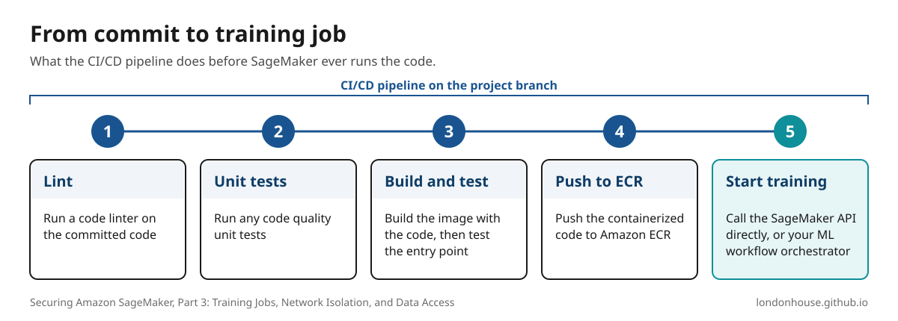

Securing the SageMaker domain doesn't secure the training jobs users launch from it. To secure training, use scanned, prebuilt container images in Amazon ECR, keep code in Git and deliver it to AWS only through a scoped CI/CD role, encrypt your data and limit the training execution role to the job's S3 prefixes, and run every training job in your private subnets with `VpcConfig` and `EnableNetworkIsolation` turned on.

<a href="/assets/diagrams/sagemaker-training-housing-travel.svg" title="Open the full-size diagram"><picture><source media="(max-width: 640px)" srcset="/assets/diagrams/sagemaker-training-housing-travel-mobile.svg"></picture></a>

## We've secured the SageMaker domain. What happens when users start working in it?

Now that you've secured the domain, the next area to focus on is how users actually use that domain.

Ideally, data scientists and analysts log into a notebook or code editor. They're going to run queries, explore data, do data processing, and then focus on local notebook training jobs. I'll note that I've generally used a multi-account approach to where SageMaker domains may be deployed to several AWS accounts. Data scientists can have their own development account where training jobs are run or scheduled from their own notebooks, but once they think they've gotten their code to a good place, just like a software engineer, a good practice is to commit their code to a source repository and deploy a training job with a larger dataset or to another account for promotions.

You can have a CI/CD pipeline for the desired commit branch and that pipeline should consist of packaging the user's code for S3 or joining it with a pre-built Docker container. For containerization, SageMaker uses images hosted in Amazon ECR. So first, let's focus there.

<a href="/assets/diagrams/sagemaker-training-code-pipeline.svg" title="Open the full-size diagram"><picture><source media="(max-width: 640px)" srcset="/assets/diagrams/sagemaker-training-code-pipeline-mobile.svg"></picture></a>

## Why do you prefer prebuilt container images for SageMaker training?

I prefer prebuilt container images for training, because they allow you to address code package vulnerabilities and image rehydration requirements set by most organizations.

You could use a source-code repository and, on a predetermined cadence, automate building and scanning a container. Use something like Prisma Cloud or [Trivy](https://trivy.dev/ "Trivy") to scan it and check and address vulnerabilities before they make it into your cloud accounts and workflows. Once those risks are resolved to a point where the organization or security team is satisfied, you can host that image in an ECR repository.

ECR also supports scanning and has the ability for the above-mentioned scanners to connect and scan its hosted images. A great security practice is to turn on [ECR enhanced scanning](https://docs.aws.amazon.com/AmazonECR/latest/userguide/image-scanning-enhanced.html "Scan images for OS and programming language package vulnerabilities in Amazon ECR") with continuous scan, which rescans your hosted images as new vulnerabilities are published.

Now that images are more secure, a data scientist doesn't have to be concerned with the container image itself; they can focus on using the image to run their training jobs.

## How do you secure the code and data a training job uses?

OK, so now that you have a container and code, let's talk about securing the submission of the code to SageMaker.

Overall, your security concerns are going to be related to housing and travel.

- You've secured the domain in [Part 1](/articles/securing-sagemaker-vpc-only-mode/ "Securing Amazon SageMaker, Part 1: Private Networking with VPC-Only Mode")
- You've secured user authentication in [Part 2](/articles/sagemaker-studio-user-authentication/ "Securing Amazon SageMaker, Part 2: Domain User Authentication")

Now it's time to focus on where the code and data are housed, and how those artifacts or resources are secured in transit, or travel.

### Code

**Housing**

I've been places where code is kept on local or cloud notebooks, and that's a big "_NO, NO_". 
Today, Amazon SageMaker allows you to integrate your git repositories:

- [SageMaker Studio Classic](https://docs.aws.amazon.com/sagemaker/latest/dg/studio-git-attach-console.html "Attach a Git Repository from the SageMaker AI Console for Amazon SageMaker Studio Classic"): suggested code repositories on the domain or user profile
- [SageMaker Unified Studio](https://docs.aws.amazon.com/sagemaker-unified-studio/latest/adminguide/git-connections.html "Git connections"): Git connections through AWS CodeConnections

I typically use the standard method of allowing users to run terminal commands or pre-built shell scripts to initialize their remote git repositories.
Using GitHub, GitLab or others, you can create pre-built repository templates and have users clone those in their workspaces, write their code and commit back to the remote repository. This method allows you to perform security from the repository level. Most enterprise-ready git repository hosts have team-level security that can be leveraged to secure code away from unauthorized users and even allow scans.

**Travel**

This concept is more of a DevOps concept, but as an MLOps engineer the discipline overlaps. In this example I'll admit I'm more familiar with using GitLab and GitHub, but the process may be similar with other systems. The CI/CD pipeline to deliver the code can use [OIDC](https://docs.github.com/en/actions/how-tos/secure-your-work/security-harden-deployments/oidc-in-aws "Configuring OpenID Connect in Amazon Web Services") to connect to AWS and deliver the job with project-specific roles that you deployed when the project was created.
Here's what that role looks like in Terraform. The project name is passed in as a variable, so every project gets its own deploy role. 

The role can only upload to the project's code prefix, launch training jobs named after the project that run in your training subnets with network isolation on, and pass the project's own execution role to SageMaker.

```hcl
data "aws_partition" "current" {}

# The GitHub OIDC provider is created once per account, not per project
data "aws_iam_openid_connect_provider" "github" {
  url = "https://token.actions.githubusercontent.com"
}

locals {
  partition = data.aws_partition.current.partition
  # Every training job this project launches must start with the project name
  training_job_arn = "arn:${local.partition}:sagemaker:${var.region}:${var.account}:training-job/${var.project_name}-*"
}

resource "aws_iam_role" "project_deploy" {
  name = "${var.project_name}-training-deploy"
  tags = var.tags

  # Only this project's repository, on main, can assume the role
  assume_role_policy = jsonencode({
    Version = "2012-10-17"
    Statement = [
      {
        Effect = "Allow"
        Principal = {
          Federated = data.aws_iam_openid_connect_provider.github.arn
        }
        Action = "sts:AssumeRoleWithWebIdentity"
        Condition = {
          StringEquals = {
            "token.actions.githubusercontent.com:aud" = "sts.amazonaws.com"
            "token.actions.githubusercontent.com:sub" = "repo:${var.github_org}/${var.project_name}:ref:refs/heads/main"
          }
        }
      },
    ]
  })
}

resource "aws_iam_role_policy" "project_deploy" {
  name = "${var.project_name}-training-deploy"
  role = aws_iam_role.project_deploy.id

  policy = jsonencode({
    Version = "2012-10-17"
    Statement = [
      {
        Sid      = "UploadProjectCode"
        Effect   = "Allow"
        Action   = ["s3:PutObject"]
        Resource = ["arn:${local.partition}:s3:::${var.artifact_bucket}/${var.project_name}/code/*"]
      },
      {
        # Jobs must run in the training subnets, with the training security group, and network isolated
        Sid      = "CreateIsolatedTrainingJobs"
        Effect   = "Allow"
        Action   = ["sagemaker:CreateTrainingJob"]
        Resource = [local.training_job_arn]
        Condition = {
          Bool = {
            "sagemaker:NetworkIsolation" = "true"
          }
          "ForAllValues:StringEquals" = {
            "sagemaker:VpcSubnets"          = var.training_subnet_ids
            "sagemaker:VpcSecurityGroupIds" = [var.training_security_group_id]
          }
          # Without this, a request with no VpcConfig at all passes the ForAllValues check
          Null = {
            "sagemaker:VpcSubnets"          = "false"
            "sagemaker:VpcSecurityGroupIds" = "false"
          }
        }
      },
      {
        Sid      = "TrackProjectTrainingJobs"
        Effect   = "Allow"
        Action   = ["sagemaker:DescribeTrainingJob", "sagemaker:AddTags"]
        Resource = [local.training_job_arn]
      },
      {
        # The pipeline can hand SageMaker this project's execution role and nothing else
        Sid      = "PassProjectExecutionRole"
        Effect   = "Allow"
        Action   = ["iam:PassRole"]
        Resource = [aws_iam_role.training_execution.arn]
        Condition = {
          StringEquals = {
            "iam:PassedToService" = "sagemaker.amazonaws.com"
          }
        }
      },
    ]
  })
}
```

This method locks down how code is delivered, as the runner can only do what the role specifies. Only least privileged, no open role or human involved. SageMaker training jobs will either accept an S3 location declaration of packaged code or ECR image for code location arguments.

### Data

**Housing**

Data is typically going to be either housed in S3 or transferred from a _datalake_ like Snowflake or Databricks.

[Feature stores](https://www.databricks.com/blog/what-feature-store-complete-guide-ml-feature-engineering "What is a Feature Store? A Complete Guide to ML Feature Engineering") are also noteworthy when speaking on data housing, offline features specifically as it's at rest or _"housed"_ data. I'm going to stick to S3 at this time to stay simple and AWS-centric.

S3 already encrypts every new object with [SSE-S3](https://docs.aws.amazon.com/AmazonS3/latest/userguide/UsingServerSideEncryption.html "Using server-side encryption with Amazon S3 managed keys (SSE-S3)") (Amazon S3 managed keys) by default, so typically consider SSE-KMS with a customer managed key, which gives you a key policy and a CloudTrail record of every decrypt.
Make sure the [IAM execution role](https://docs.aws.amazon.com/sagemaker/latest/dg/sagemaker-roles.html "How to use SageMaker AI execution roles") assumed by the SageMaker training job has a scoped-down policy limiting access only to the specific S3 bucket prefixes required for that job.
When data has entered the training job, the host machine typically moves that data to the attached EBS volume of the training instance. 

**Travel**

When creating buckets it's best practice to [enable secure transport](https://docs.aws.amazon.com/AmazonS3/latest/userguide/example-bucket-policies.html#example-bucket-policies-HTTP-HTTPS "Examples of Amazon S3 bucket policies") (`aws:SecureTransport`) on your bucket policies to explicitly block unencrypted HTTP data movement. You can also enable [inter-container traffic encryption](https://docs.aws.amazon.com/sagemaker/latest/dg/train-encrypt.html "Protect Communications Between ML Compute Instances in a Distributed Training Job") (`EnableInterContainerTrafficEncryption=True`). 
This setting encrypts the traffic between the instances of a distributed training job, so it only applies when a job runs on more than one instance. In my experience, large training jobs should always be distributed; a large job on a single instance ends up slow and expensive. So for any job big enough to matter, plan on turning this on. 
Distributed jobs already need a [self-referencing inbound rule](https://docs.aws.amazon.com/sagemaker/latest/dg/train-vpc.html#train-vpc-groups "Give SageMaker AI Training Jobs Access to Resources in Your Amazon VPC") on the job's security group so the instances can reach each other. Before you turn on encryption, also add self-referencing rules for UDP port 500 and the ESP protocol (50), which AWS requires for this setting. Expect a small increase in training time as AWS notes the encryption can slow down jobs that do a lot of communication between instances.

## Does VPC-only mode on the domain also secure training jobs?

No, this will also have to be addressed to ensure you're running a secure environment.

Similar to how the domain was deployed, you can configure networking to make sure the training infrastructure is locked down. To better understand it, we can talk about how training jobs behave by default. 

Think back to when we created the domain, we put it in VPC-only mode to ensure the networking stays inside of AWS's backbone network. This was done because the domain is inside of an AWS-hosted VPC. 
Similar to the domain, SageMaker training uses AWS-managed infrastructure. You can [configure jobs to run in your VPC](https://docs.aws.amazon.com/sagemaker/latest/dg/train-vpc.html "Give SageMaker AI Training Jobs Access to Resources in Your Amazon VPC") by setting `VpcConfig` and passing in a security group to control traffic along with your private subnets. Since you already have VPC endpoints configured from [Part 1](/articles/securing-sagemaker-vpc-only-mode/ "Securing Amazon SageMaker, Part 1: Private Networking with VPC-Only Mode"), your communication will travel through the AWS network to the needed resources like S3. Just make sure the training subnets' route tables include the S3 gateway endpoint, and that the training job's security group is allowed into your interface endpoints the same way the [Studio security group](/articles/securing-sagemaker-vpc-only-mode/#lets-recap "Securing Amazon SageMaker, Part 1: Private Networking with VPC-Only Mode") is.

To ensure everything is locked down, pair this with [network isolation](https://docs.aws.amazon.com/sagemaker/latest/dg/mkt-algo-model-internet-free.html#mkt-algo-model-internet-free-isolation "Run Training and Inference Containers in Internet-Free Mode") mode (`EnableNetworkIsolation=True`). This will stop the container running on the host machine from making outbound calls. SageMaker does the S3 work for the container, using your execution role. Before your training script starts, SageMaker downloads the input data and code from S3 through your private subnets, which is why the S3 gateway endpoint from [Part 1](/articles/securing-sagemaker-vpc-only-mode/#should-sagemaker-use-an-s3-gateway-or-interface-endpoint "Should SageMaker use an S3 gateway or interface endpoint?") still matters with isolation turned on.


Let's review our stance.

- Images are addressed and secured
- Code is stored in Git and delivered only by a scoped pipeline role
- Data is secured at rest and in transit
- We've reviewed the networking for training jobs
  - Configure `VpcConfig`
  - Set `EnableNetworkIsolation=True`

We've essentially secured a great working environment for data scientists to work inside of, store, deliver their code and launch training jobs.
Next, we'll cover security considerations for model artifacts and approving models for secure endpoints.

*Previously: [Part 2 — Securing SageMaker Domain user authentication](/articles/sagemaker-studio-user-authentication/)*
